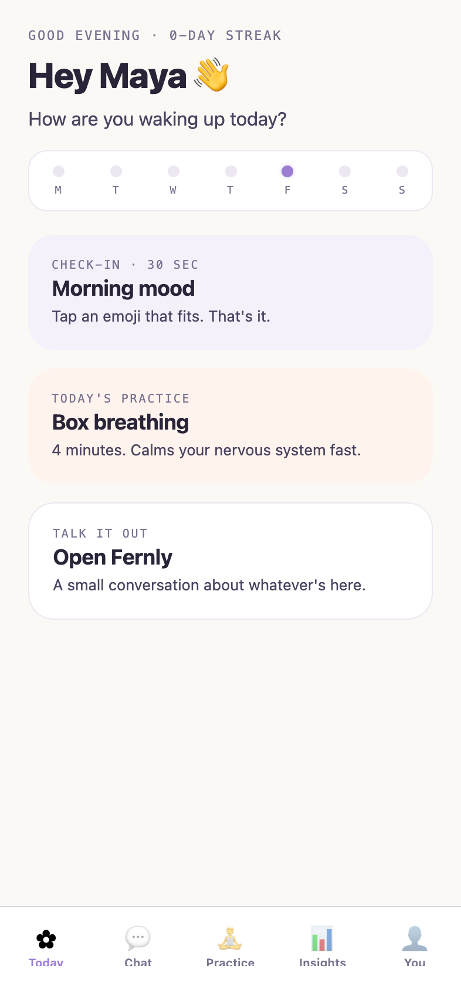
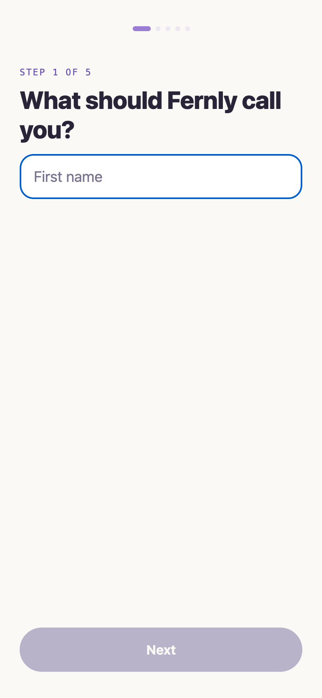
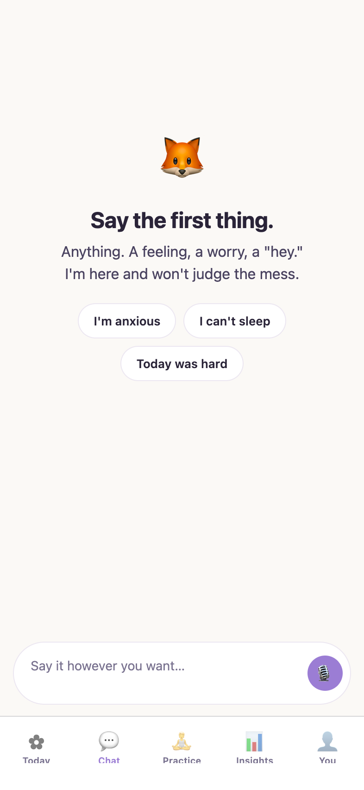
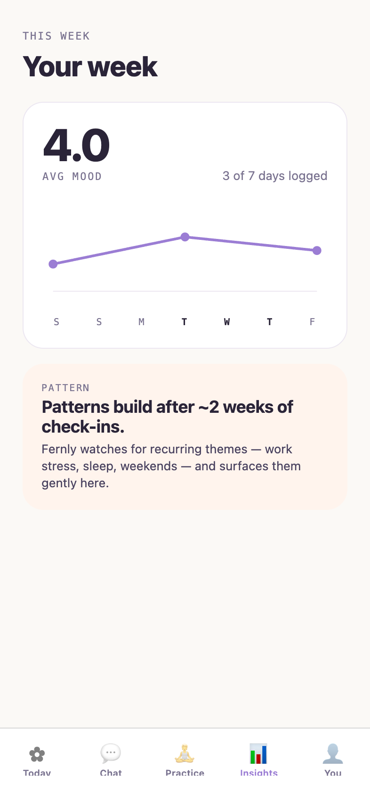
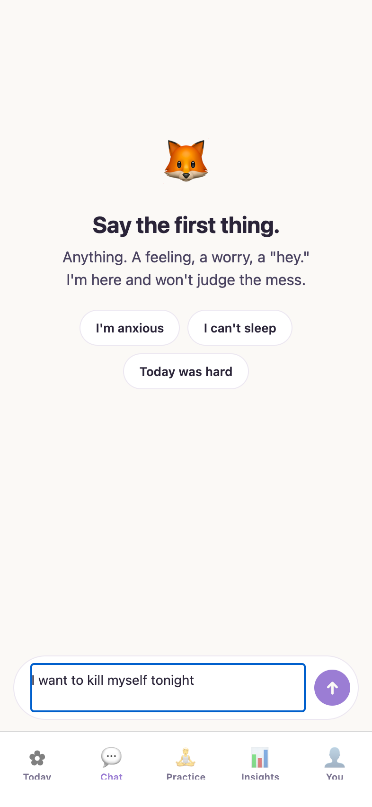

# Fernly

A gentle, mobile-first wellness companion for Gen Z, built with Expo and React Native. Mood check-ins, short CBT/ACT practices and a supportive chat, with crisis detection that always comes first.



## What it does

Fernly is an early-stage (v0.9, pre-release) wellness app that mixes ideas from cognitive behavioural therapy (CBT) and acceptance and commitment therapy (ACT) into small daily moments: a 30-second mood check-in, a few minutes of practice, and a place to talk things through. It runs on iOS, Android and the web from one TypeScript codebase.

Fernly is not therapy and does not replace professional care. Every chat message passes through an on-device crisis detector before anything else happens; if it matches, the user sees localized crisis line resources and the message is never sent to a chat backend.

## Features

- **Onboarding**: five steps (name, mood, goals, mascot, preferred tone) with validation, saved to the device
- **Today**: greeting, weekly streak strip and three cards (mood check-in, today's practice, chat)
- **Mood check-in**: emoji picker with quick-word tags
- **Chat**: tone-aware replies (soft, direct or playful). Uses a configurable chat backend when one is set and falls back to on-device placeholder replies otherwise
- **Practice**: a library of eight CBT, ACT and body-based exercises; box breathing (live 4-4-4-4 cycle) is fully built, the rest are marked "coming soon"
- **Insights**: SVG line chart of mood over time with an average
- **Profile and settings**: stats, mascot avatar and a full local reset
- **Crisis detection**: hard-pattern and soft-signal detector with an always-on-top modal and locale-aware hotline numbers (for example 988 in the US)
- **Sensitive data partition**: chat history is kept in `expo-secure-store` (Keychain / Keystore); profile and mood data in AsyncStorage
- **Optional crash reporting** via Sentry, only when a real DSN is configured

### Screenshots

| Onboarding | Chat | Insights | Crisis modal |
|---|---|---|---|
|  |  |  |  |

The full design system, 30 screen mocks and brand mark explorations are in [`spec/index.html`](spec/index.html) (open it in a browser).

## Tech stack

| Layer | Technology |
|---|---|
| App | Expo SDK 57, React Native 0.86, React 19, TypeScript |
| Navigation | React Navigation 7 (bottom tabs + native stack) |
| Storage | AsyncStorage, expo-secure-store |
| Native | expo-haptics, expo-localization, react-native-svg |
| Web | react-native-web |
| Monitoring | sentry-expo (opt-in) |
| Testing | Vitest |
| Quality | ESLint, Prettier, `tsc --noEmit` |
| Release | EAS Build and Submit, triggered by version tags |

## Getting started

Requires Node 20 or newer.

```bash
git clone https://github.com/camster91/fernly.git
cd fernly
npm install
npm run web          # Expo in the browser
npm start            # Expo dev server (scan with Expo Go or open a simulator)
```

Native development builds:

```bash
npm run ios
npm run android
```

Optional environment variables (set them in your shell or an untracked `.env`):

- `EXPO_PUBLIC_CHAT_API_URL`: base URL of a chat backend that accepts `POST /chat`. Without it, chat uses local placeholder replies.
- `EXPO_PUBLIC_SENTRY_DSN`: enables Sentry crash reporting.

## Testing

```bash
npm test             # crisis detector suite, then all unit tests
npm run test:crisis  # crisis detector only
npm run ci           # typecheck, lint, format check and tests
```

Unit tests cover the crisis detector and its locale resources, the chat backend adapter, storage and date helpers.

## Project structure

```
App.tsx              # App root
index.ts             # Entry point and optional Sentry setup
src/
├── screens/         # Onboarding, Today, Mood check-in, Chat, Practice, Exercise, Insights, Profile, Settings
├── components/      # Card, MoodPicker, CrisisModal, ErrorBoundary, ScreenContainer
├── safety/          # Crisis detector and resources
├── api/             # Chat backend adapter
├── nav/             # Navigation
├── data/            # Exercises and mascots
├── storage.ts       # AsyncStorage and SecureStore partition
└── theme.ts         # Design tokens
spec/                # Design system, screen mocks and app screenshots
plans/               # Product plan and reviews
```

## Design

Soft pastel palette with lavender as the primary accent and peach, mint and rose as supporting colours on a warm off-white background. All tokens live in `src/theme.ts` and are mirrored in the design spec.

See [plans/01-product-plan.md](plans/01-product-plan.md) for positioning and the product plan, and [SECURITY.md](SECURITY.md) for reporting security issues.

## License

All rights reserved. See [LICENSE](LICENSE).
